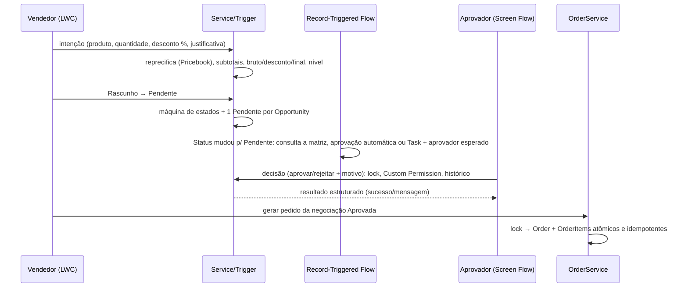

# ARQUITETURA — Desafio Nível 2: Gestão de Negociações e Aprovação Comercial

> **Escopo:** solução completa (US-01 a US-07): simulador LWC, negociação e itens, roteamento de alçada (Flow), decisão (Screen Flow), FlexiPage e geração de Order.
> As seções 5 e 6 definem o contrato de dados e o ownership de campos que as automações respeitam.
> Decisões, arredondamento e limitações estão em [DECISOES_E_LIMITACOES.md](DECISOES_E_LIMITACOES.md).

---

## 1. Visão geral em camadas

```mermaid
flowchart LR
  subgraph UI[Interface]
    SIM[LWC trainingNegotiationSimulator<br/>Opportunity]
    SUM[LWC trainingNegotiationSummary]
    ACT[LWC trainingNegotiationActions]
    FP[FlexiPage Negociacao_Comercial<br/>Resumo e ações LWC + detalhes padrão]
    SF[Screen Flow<br/>Negociacao_Decisao_Aprovacao]
  end
  subgraph APEX[Apex]
    CTRL[TrainingNegotiationController<br/>TrainingOrderController<br/>finos]
    NS[TrainingNegotiationService]
    AS[TrainingApprovalService]
    OS[TrainingOrderService]
    DA[TrainingApprovalDecisionAction<br/>@InvocableMethod]
    RA[TrainingApprovalRoutingAction<br/>@InvocableMethod]
    RES[TrainingApproverResolver]
  end
  subgraph DATA[Dados e integridade]
    TN[Trigger Negociacao_Comercial__c<br/>TrainingNegotiationHandler]
    TI[Trigger Item_Negociacao__c<br/>TrainingNegotiationItemHandler]
    RC[TrainingNegotiationRecalcService]
    MDT[(Aprovacao_Nivel__mdt)]
    NEG[(Negociacao_Comercial__c)]
    ITM[(Item_Negociacao__c)]
    HIS[(Historico_Decisao__c)]
    ORD[(Order / OrderItem)]
  end
  RTF[Record-Triggered Flow<br/>Negociacao_Roteamento_Aprovacao]

  FP --> SUM & ACT
  SIM & ACT --> CTRL --> NS
  ACT --> SF --> DA --> AS
  ACT --> CTRL --> OS --> ORD
  NS --> NEG & ITM
  ITM --> TI --> RC --> NEG
  NEG --> TN
  NEG -- Status vira Pendente --> RTF
  RTF --> MDT
  RTF --> RA --> RES
  RA --> AS
  AS --> HIS
  AS --> NEG
```

**Regra de dependência:** a UI só fala com Controllers ou Invocables; estes só delegam a Services. Controller nunca contém regra de negócio,
Trigger só delega ao Handler e o Flow nunca recalcula valores financeiros. O servidor é sempre a fonte da verdade: o LWC envia apenas
produto, quantidade e desconto, e preço, totais e nível são resolvidos no Apex.

### Fluxo ponta a ponta (jornada do desafio)



---

## 2. Responsabilidades por componente

| Camada | Componente | Responsabilidade | NÃO faz |
|---|---|---|---|
| LWC | `trainingNegotiationSimulator` | montar itens, prévia de totais, validação de UX, enviar **apenas** produto/quantidade/desconto | decidir preço, aplicar regra de negócio definitiva |
| LWC | `trainingNegotiationSummary` | resumo, indicadores, itens, motivo da rejeição, aprovador esperado (reutilizado no Screen Flow) | alterar dados |
| LWC | `trainingNegotiationActions` | exibe botões conforme status/permissão; abre modal do simulador e do Screen Flow | autorizar (só exibe; o servidor revalida) |
| Apex Controller | `Training*Controller` | traduzir exceções em `AuraHandledException` | regra de negócio |
| Apex Service | `TrainingNegotiationService` | reprecificar no servidor (Pricebook), salvar com savepoint, submeter/reabrir/cancelar, DML em modo usuário | cálculo de totais do pai (é da Trigger) |
| Apex Service | `TrainingApprovalService` | decisão com lock de linha, autorização por Custom Permission, auditoria, aprovação automática | roteamento (é do Flow) |
| Apex Service | `TrainingOrderService` | Order + OrderItems atômicos e idempotentes | — |
| Trigger/Handler | Negociação | transições de status, congelamento, `Valor_Desconto/Final`, `Nivel_Aprovacao`, ciclo, unicidade de Pendente | criar tarefa |
| Trigger/Handler | Item | validações, `Subtotal`, bloqueio por status, recálculo do pai (bulk) | rotear aprovação |
| Flow (record-triggered) | Roteamento | dispara só em `Status → Pendente`; consulta a matriz (MDT); aprovação automática ou Task idempotente + aprovador esperado | recalcular valores |
| Flow (screen) | Decisão | UI de decisão; chama a ação Apex que valida no servidor | autorizar sozinho |
| Metadados | `Aprovacao_Nivel__mdt` | faixas, Custom Permission e aprovador opcional por nível | — |

A FlexiPage implantada não usa Dynamic Forms nem regras `visibilityRule`: ela contém o resumo e as ações em LWC,
além do painel padrão de detalhes. A visibilidade por estado é controlada dentro de `trainingNegotiationActions`;
é uma conveniência de interface, não um controle de autorização.

---

## 3. Estrutura do repositório e catálogo de classes

```
force-app/main/default/
  classes/            Apex (Controllers, Services, Handlers, Actions, testes)
  triggers/           TrainingNegotiationTrigger, TrainingNegotiationItemTrigger
  lwc/                trainingNegotiationSimulator, trainingNegotiationSummary, trainingNegotiationActions
  flows/              Negociacao_Roteamento_Aprovacao, Negociacao_Decisao_Aprovacao
  flexipages/         Negociacao_Comercial_Record_Page, Opportunity_Simulador_Record_Page
  objects/            Negociacao_Comercial__c, Item_Negociacao__c, Historico_Decisao__c, Aprovacao_Nivel__mdt, campos em Order
  customMetadata/     matriz de aprovação (4 níveis)
  customPermissions/  Aprovar_Negociacao_Gerente / Diretor / Financeiro
  permissionsets/     Training_Vendedor + 3 aprovadores
  applications/ tabs/ App "Training Negociações" e aba da negociação
docs/                 esta documentação
scripts/apex/         seed-demo.apex
```

### Classes de produção

| Classe | Compartilhamento | Papel |
|---|---|---|
| `TrainingConstants` | with sharing | status, nível automático, limite de 30% e status do Order |
| `TrainingException` | — | exceção de negócio |
| `TrainingApprovalMatrix` | with sharing | leitura da matriz em `Aprovacao_Nivel__mdt.getAll()`; faixa `(mín, máx]` |
| `TrainingNegotiationContext` | with sharing | estado de transação: `recalculating` (anti-recursão) e `decisionAuthorized` (marcador de fluxo) |
| `TrainingNegotiationRequest` | with sharing | DTO de entrada do simulador (JSON desserializado) |
| `TrainingNegotiationService` | with sharing | catálogo, rascunho, salvar/submeter/reabrir/cancelar, visão da negociação, mensagens amigáveis |
| `TrainingNegotiationHandler` | with sharing | Trigger da negociação: cálculos, transições, unicidade de Pendente, validação de decisão |
| `TrainingNegotiationItemHandler` | with sharing | Trigger do item: validação, `Subtotal`, bloqueio por status, dispara o recálculo |
| `TrainingNegotiationRecalcService` | **without** sharing | soma os subtotais e grava `Valor_Bruto__c` no pai (integridade) |
| `TrainingApprovalService` | with sharing | `decide`, `autoApprove`, `logRouting`, `closeApprovalTasks` (`TaskCloser` interno é without sharing) |
| `TrainingApproverResolver` | **without** sharing | resolve o aprovador do nível (objetos de setup); sem IDs fixos |
| `TrainingHistoryService` | **without** sharing | única gravação de `Historico_Decisao__c` (auditoria) |
| `TrainingOrderService` | with sharing | `generateOrder` atômico e idempotente |
| `TrainingNegotiationController` | with sharing | `@AuraEnabled` do simulador e das ações |
| `TrainingOrderController` | with sharing | `@AuraEnabled` da geração de pedido |
| `TrainingApprovalDecisionAction` | with sharing | `@InvocableMethod` do Screen Flow de decisão |
| `TrainingApprovalRoutingAction` | with sharing | `@InvocableMethod` do Flow de roteamento |

### Testes

`TrainingNegotiationServiceTest`, `TrainingNegotiationTriggerTest`, `TrainingApprovalServiceTest`, `TrainingOrderServiceTest` e `TrainingTestDataFactory`.
Resultado e cobertura: [TESTES_E_EVIDENCIAS.md](TESTES_E_EVIDENCIAS.md).

---

## 4. Estratégias transversais

### 4.1 Dinheiro e arredondamento
Duas casas, `HALF_UP`. `Subtotal = round(Qtd × Preço)`, `Valor_Desconto = round(Bruto × % / 100)`, `Valor_Final = Bruto − Desconto`. O JavaScript só replica para prévia.

### 4.2 Matriz de aprovação (somente metadado)
`Aprovacao_Nivel__mdt` define faixa, Custom Permission e aprovador opcional por nível. Nenhuma faixa vive em código ou Flow.

| Nível | Faixa de desconto | Custom Permission |
|---|---|---|
| Automática | 0% a 5% | — (aprovação automática) |
| Gerente | > 5% a 10% | `Aprovar_Negociacao_Gerente` |
| Diretor | > 10% a 20% | `Aprovar_Negociacao_Diretor` |
| Financeiro | > 20% a 30% | `Aprovar_Negociacao_Financeiro` |

Acima de 30% a submissão é bloqueada (`TrainingConstants.DESCONTO_MAXIMO`).

### 4.3 Recursão
Sem flag global "já executei". A Trigger de item atualiza o pai sob `TrainingNegotiationContext.recalculating`, restaurado em `finally`.
O Flow não reentra porque exige **mudança** de `Status__c` para Pendente.

### 4.4 Decisão controlada
`Pendente → Aprovada/Rejeitada` só passa na Trigger se `decisionAuthorized` estiver ativo (marcador de fluxo, não permissão) **e** o Handler validar a Custom Permission do nível e o decisor. Aprovação automática só é aceita quando o nível calculado é `Automática`.

### 4.5 Concorrência e idempotência

| Cenário | Mecanismo |
|---|---|
| Duas decisões simultâneas | `SELECT ... FOR UPDATE` + checagem `Status = Pendente` |
| Duas gerações de Order | `FOR UPDATE` + `Order.Negociacao_Origem_Id__c` único + retorno do pedido existente |
| Duas Pendentes na mesma Opportunity | checagem na Trigger + `Chave_Pendente__c` único |
| Reprocesso do Flow | entrada por mudança de status + `Task.Chave_Idempotencia__c = Id-ciclo` |

### 4.6 Segurança
Services `with sharing`; SOQL/DML do usuário em modo usuário (`WITH USER_MODE`, `as user`). Autorização de decisão por Custom Permission, validada no servidor.
`Historico_Decisao__c` é somente leitura para usuários. Exceções `without sharing`: `RecalcService`, `ApproverResolver`, `TaskCloser`, `HistoryService`.

---

## 5. Modelo de dados

| Objeto | Papel | Campos principais |
|---|---|---|
| `Negociacao_Comercial__c` | pai da negociação (lookup para Opportunity) | `Status__c`, `Percentual_Desconto__c`, `Valor_Bruto__c`, `Valor_Desconto__c`, `Valor_Final__c`, `Nivel_Aprovacao__c`, `Ciclo_Aprovacao__c`, `Aprovador__c`, `Data_Aprovacao__c`, `Motivo_Rejeicao__c`, `Justificativa__c`, `Chave_Pendente__c` |
| `Item_Negociacao__c` | itens (detalhe da negociação) | `Produto__c`, `Quantidade__c`, `Preco_Unitario__c`, `Subtotal__c` |
| `Historico_Decisao__c` | auditoria de roteamento e decisões | `Ciclo__c`, `Decisao__c`, `Status_Anterior__c`, `Status_Novo__c`, `Nivel_Aprovacao__c`, `Aprovador_Esperado__c`, `Usuario__c`, `Motivo__c`, `Origem__c`, `Data_Hora__c` |
| `Aprovacao_Nivel__mdt` | matriz de aprovação | `Nivel__c`, `Percentual_Minimo__c`, `Percentual_Maximo__c`, `Aprovacao_Automatica__c`, `Custom_Permission__c`, aprovador (username) opcional |
| `Order` (campos extras) | vínculo com a origem | `Negociacao_Comercial__c`, `Negociacao_Origem_Id__c` (único), `Oportunidade_Origem__c` |
| `Task` (campo extra) | tarefa de aprovação | `Chave_Idempotencia__c` |

Status: `Rascunho → Pendente | Cancelada`; `Pendente → Aprovada | Rejeitada | Cancelada`; `Rejeitada → Rascunho | Cancelada`; `Aprovada` e `Cancelada` são finais.
Itens só mudam em Rascunho.

Acesso: `Training_Vendedor` (monta, envia, gera pedido) e `Training_Aprovador_Gerente/Diretor/Financeiro` (cada um com sua Custom Permission).

---

## 6. Ownership de campos (evita automações conflitantes)

| Campo | Dono |
|---|---|
| `Valor_Bruto__c` | Trigger de itens (via `RecalcService`) |
| `Valor_Desconto__c`, `Valor_Final__c`, `Nivel_Aprovacao__c`, `Ciclo_Aprovacao__c`, `Chave_Pendente__c` | Trigger da negociação |
| `Aprovador__c` (esperado, enquanto Pendente) | Flow de roteamento |
| `Status__c` Pendente→Aprovada/Rejeitada, `Data_Aprovacao__c`, `Motivo_Rejeicao__c`, `Aprovador__c` (decisor) | `TrainingApprovalService` |
| `Status__c` Rascunho→Pendente, Rejeitada→Rascunho, Cancelada | vendedor via `TrainingNegotiationService` |
| `Subtotal__c` | Trigger de itens |
| `Historico_Decisao__c` | `TrainingHistoryService` (modo sistema; usuários só leem) |

---

## 7. Documentos relacionados

| Arquivo | Conteúdo |
|---|---|
| [DECISOES_E_LIMITACOES.md](DECISOES_E_LIMITACOES.md) | arredondamento, recursão, concorrência, segurança, limitações conhecidas |
| [TESTES_E_EVIDENCIAS.md](TESTES_E_EVIDENCIAS.md) | testes Apex, validação dos Flows e evidências |
| [MATRIZ_RASTREABILIDADE.md](MATRIZ_RASTREABILIDADE.md) | US/CA → componente → teste |
| [RESPOSTAS_CODE_REVIEW.md](RESPOSTAS_CODE_REVIEW.md) | respostas às perguntas do code review |
| [ROTEIRO_DEMO.md](ROTEIRO_DEMO.md) | passo a passo da demonstração |
